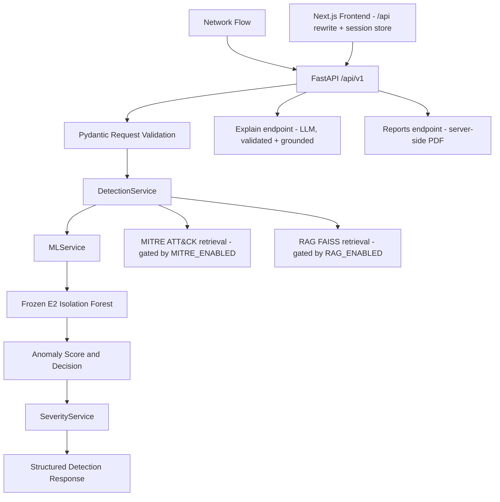

# Backend API

The backend serves the frozen E2 (`with_port`) CICIDS2017 Isolation Forest model through FastAPI, plus MITRE
ATT&CK RAG retrieval, grounded LLM explanations, and server-side PDF incident reports. It accepts one network
flow or a batch of flows, validates the request, reproduces the validated per-flow preprocessing, returns an
anomaly score and decision, and adds severity classification with retrieved/explanatory context.

```text
Network Flow
     |
     v
FastAPI /api/v1
     |
Pydantic Validation
     |
Frozen E2 Isolation Forest
     |
Anomaly Score
     |
Severity (+ MITRE RAG / LLM explanation on their own surfaces)
     |
Structured API Response / PDF Report
```

The backend keeps no server-side detection-history persistence (no database, no record-listing endpoint).
Full route/schema details live in `API_CONTRACT.md`; service boundaries in `ARCHITECTURE.md`.

## Model Boundary

The primary detector is:

- Experiment: `with_port`
- Features: 60
- Model version: `isolation_forest_v1`
- Default operating point: `OP-A`
- OP-A threshold: `0.5219193851693676`
- OP-B threshold: `0.4878500998020172`
- Score semantics: higher `anomaly_score` means more anomalous

The inference decision is equivalent to:

```python
scores = -model.score_samples(X.values)
is_anomaly = scores >= threshold
```

The model and preprocessing artifacts are frozen. The API does not retrain, tune, mutate thresholds, run
dataset-level preprocessing, or persist detection history.

## Setup

From the repository root (Windows PowerShell):

```powershell
cd demo\backend
python -m pip install -r requirements.txt
```

Note: `requirements.txt` constrains `httpx>=0.27.0,<0.28` because Starlette 0.36's `TestClient` passes the
`app=` shortcut to `httpx.Client`, which httpx 0.28 removed. The app itself only uses `httpx.Client`,
`TimeoutException`, and `HTTPError`, so the pin changes no runtime behavior.

Copy `.env.example` to `.env` when local overrides are needed. Settings are loaded from environment variables
and the optional `.env` file.

Supported settings include:

| Variable | Purpose | Default |
| --- | --- | --- |
| `APP_ENV` | Runtime environment label | `development` |
| `LOG_LEVEL` | Application log level | `INFO` |
| `API_VERSION` | API version label | `v1` |
| `MODEL_PATH` | Frozen model artifact path | `../data/processed/experiments/with_port/model.pkl` |
| `PREPROCESSING_CONFIG_PATH` | Frozen preprocessing config path | `../data/processed/experiments/with_port/preprocessing_config.json` |
| `ACTIVE_OPERATING_POINT` | Frozen threshold policy, `OP-A` or `OP-B` | `OP-A` |
| `ALLOWED_ORIGINS` | Comma-separated CORS origins | `http://localhost:3000,http://localhost:5173` |
| `MITRE_ENABLED` | Technique IDs inside `/detect` responses | `false` |
| `RAG_ENABLED` | Retrieval context inside `/detect` and `/explain` | `false` |
| `LLM_ENABLED` | `/explain` availability | `false` |
| `MITRE_DATA_DIR` | MITRE knowledge-base directory | `../data/mitre` |
| `RAG_EMBEDDING_MODEL` | Sentence-transformers model for the FAISS index | `sentence-transformers/all-MiniLM-L6-v2` |
| `RAG_TOP_K` | Default retrieval depth | `5` |
| `LLM_PROVIDER` | `openai` (OpenAI-compatible) or `mock` (offline, deterministic) | `openai` |
| `LLM_MODEL` | Chat-completions model name | `gpt-4o-mini` |
| `LLM_API_KEY` | Provider key — inject via environment, never hard-code | _(empty)_ |
| `LLM_TEMPERATURE` | Generation temperature | `0.2` |
| `LLM_TIMEOUT` | Seconds per LLM call | `60.0` |
| `LLM_OPENAI_BASE_URL` | Compatible API base URL | `https://api.openai.com/v1` |
| `REPORTS_DIR` | Controlled PDF output directory (server-side only) | `../data/reports` |

Deterministic local demo (no key, no cost, offline-capable once the index exists):

```powershell
$env:RAG_ENABLED='true'; $env:LLM_ENABLED='true'; $env:LLM_PROVIDER='mock'
python -m uvicorn app.main:app --host 127.0.0.1 --port 8001
```

Mock-provider success validates plumbing and grounding only — never real-LLM quality or availability.

## Run the Server

```powershell
cd demo\backend
python -m uvicorn app.main:app --host 127.0.0.1 --port 8001
```

Port `8001` matches the frontend Next.js rewrite (`/api/* → http://localhost:8001/api/*`) and the smoke
scripts. The default local URLs are:

- API base: <http://localhost:8001/api/v1>
- Swagger UI: <http://localhost:8001/docs>
- OpenAPI document: <http://localhost:8001/openapi.json>

## Architecture



Responsibilities remain separate:

- ML: detection and anomaly scoring
- Severity: risk classification (placeholder calibration)
- MITRE: retrieval-based technique IDs (candidates only)
- RAG: grounded knowledge retrieval (FAISS)
- LLM: structured explanations exclusively via `/explain`
- Reports: server-side PDF generation and UUID-scoped download

The application loads `MLService` once during FastAPI lifespan startup and preloads the RAG index
best-effort. Health reports model readiness and RAG index state.

## Preprocessing

API inference operates on one raw flow at a time and uses the authoritative E2 `preprocessing_config.json`
plus model metadata:

```text
Raw feature values
        |
        v
Zero-duration handling
        |
        v
Configured log1p transformations
        |
        v
Configured signed-log transformations
        |
        v
Exact feature ordering
        |
        v
Isolation Forest
```

For a zero-duration flow, the backend adds `Is_Zero_Duration`, clips duration to `1` microsecond, and
recomputes `Flow Packets/s` and `Flow Bytes/s` before applying transformations.

The feature names, order, and transformation lists are loaded from `preprocessing_config.json` and validated
against the model metadata before the service becomes ready. The full dataset pipeline is not executed at
request time: loading raw datasets, label repair, conflict removal, deduplication, source-day splitting,
and training are outside the API.

## Operating Points

Both E2 operating points are frozen policy values:

| Operating point | Threshold |
| --- | ---: |
| `OP-A` | `0.5219193851693676` |
| `OP-B` | `0.4878500998020172` |

`ACTIVE_OPERATING_POINT=OP-A` is the default. Selecting `OP-B` is a configuration choice; the API has no
threshold mutation or tuning endpoint.

## Severity

Severity is an **INITIAL PLACEHOLDER CALIBRATION**, not a validated security-risk model:

- `critical`: score `>= 0.80`
- `high`: score `>= 0.65`
- `medium`: score `>= threshold`
- `low`: score `>= threshold * 0.90`
- `info`: score below `threshold * 0.90`

This service can later be replaced with a calibrated risk model without changing the ML detection boundary.

## API Endpoints

### `GET /api/v1/health`

Reports application and model readiness plus RAG state. See `API_CONTRACT.md` for the exact schema.

When startup artifact loading fails, the application remains available for health reporting with
`status: "degraded"` and `model_status: "not_loaded"`.

### `POST /api/v1/detect`

Scores one network flow. The JSON request uses the CICIDS-style feature aliases defined by the Pydantic
schema, such as `Destination Port`, `Flow Duration`, `Flow Bytes/s`, and `Is_Zero_Duration`. The request must
contain the 60-feature E2 contract except that `Is_Zero_Duration` is computed by the backend and may be
omitted. Values must be finite numbers and unknown fields are rejected.

Processing is:

1. Validate the request schema.
2. Apply zero-duration handling and configured transformations.
3. Enforce the authoritative feature order.
4. Compute `-model.score_samples()`.
5. Compare the score with the active frozen threshold.
6. Classify placeholder severity.
7. Attach MITRE/RAG context only when enabled (empty otherwise — detection never blocks on them).
8. Return detection, context, explanation stub, and metadata fields.

Per-feature attribution (`detected_features`) is not currently available and is not fabricated in responses.

### `POST /api/v1/detect/batch`

Accepts `{ "flows": [...] }` where each flow satisfies the complete request schema. Results preserve input
order. An empty `flows` list returns `count: 0` and an empty `results` list. Any invalid flow causes request
validation to fail rather than silently imputing values.

### `GET /api/v1/rag/status` and `POST /api/v1/rag/query`

Index status and grounded MITRE ATT&CK search (`query` 1–2000 chars, `top_k` 1–50). Missing index → controlled
`503 RAG_UNAVAILABLE`. All hits are retrieval candidates, never confirmed detections.

### `POST /api/v1/explain`

Re-runs ML → severity → RAG on the supplied flow, then returns a schema-validated, technique-grounded LLM
explanation (IDs restricted to retrieved candidates). Disabled/misconfigured LLM → controlled
`503 LLM_UNAVAILABLE`. Mock provider (`LLM_PROVIDER=mock`) is deterministic and offline.

### `POST /api/v1/reports/generate` and `GET /api/v1/reports/{report_id}/download`

Server-side PDF generation (detection + indicators + retrieved context + optional re-validated LLM
explanation) and UUID-scoped download (`application/pdf`). Bad IDs → controlled `404 REPORT_NOT_FOUND`.

## Errors

API errors use the `ErrorResponse` schema (`error_code`, `message`, `details`, `timestamp`, `request_id`).
Supported codes and HTTP mapping:

- `INVALID_INPUT` (422), `FEATURE_MISMATCH` (422), `MODEL_NOT_READY` (503)
- `INFERENCE_ERROR` (500), `INTERNAL_ERROR` (500)
- `RAG_UNAVAILABLE` (503), `LLM_UNAVAILABLE` (503), `LLM_PROVIDER_ERROR` (502), `LLM_TIMEOUT` (504),
  `LLM_VALIDATION_ERROR` (502)
- `REPORT_ERROR` (500), `REPORT_NOT_FOUND` (404)

Internal inference exception details are logged but are not exposed through the API.

## Tests

```powershell
cd demo\backend
python -m pytest tests -q        # full suite: 132 passed (87 unit + 45 integration)
python -m pytest tests/unit -q   # 87 passed
python -m pytest tests/integration -q  # 45 passed
```

Fixtures live in `tests/fixtures/sample_flows.json` (benign 0.451762/info, anomalous 0.540229/medium,
zero-duration 0.458718/info at OP-A).

## Current Backend Tree

See `ARCHITECTURE.md` for the authoritative module tree (API routes, schemas, and all services including RAG,
LLM, evidence, and report modules).

## Verification

On 2026-10-09:

- Backend tests: 132 passed, 0 failed.
- Live-HTTP checks: health, single/batch/empty-batch/invalid-input detection, RAG status/query,
  mock explanation grounding, report generation plus `%PDF-` download, and controlled 404s: PASS.
